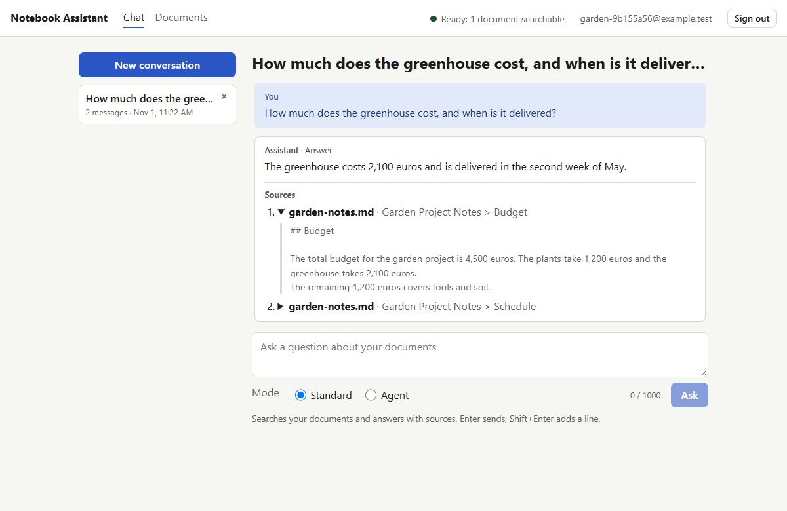
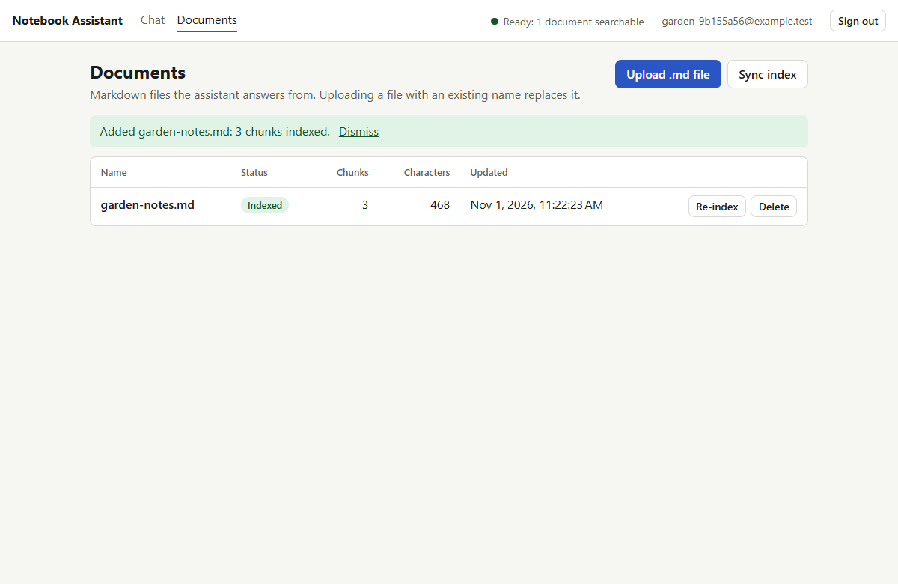
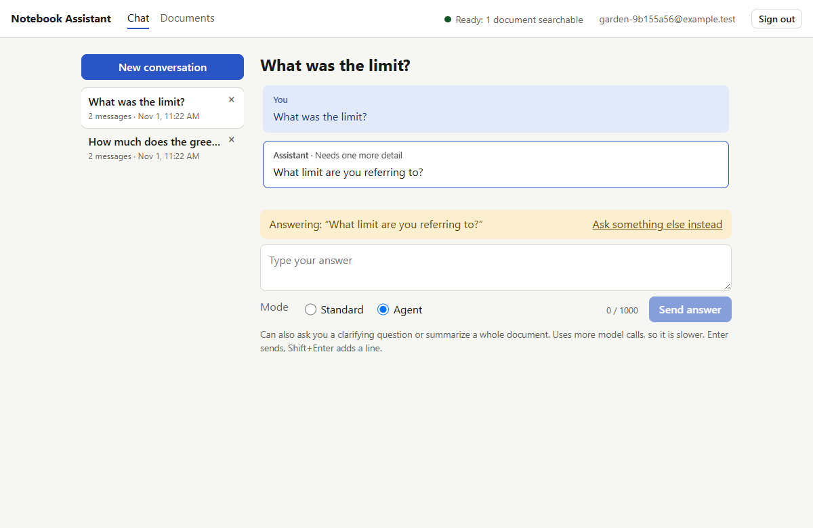
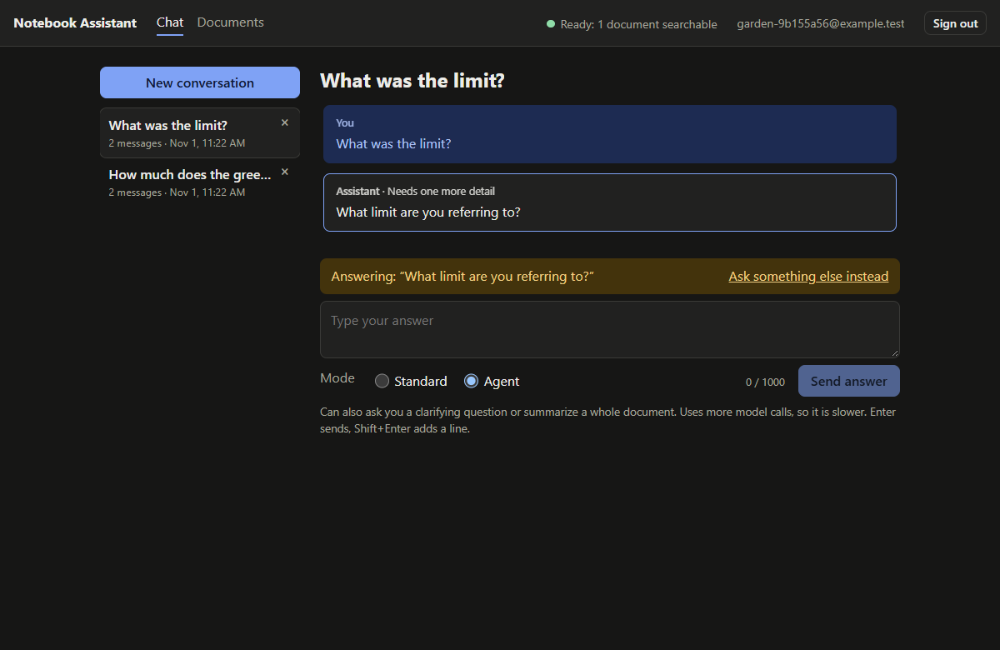
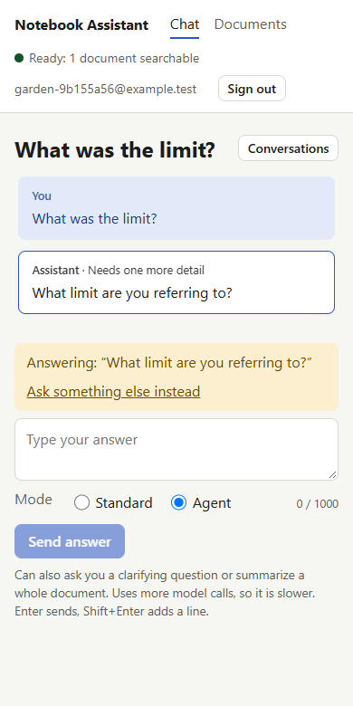
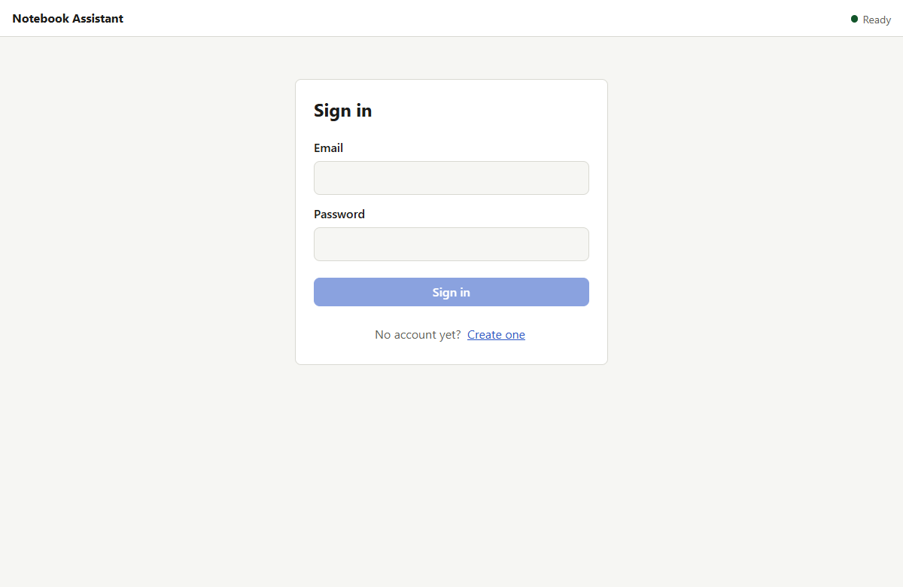
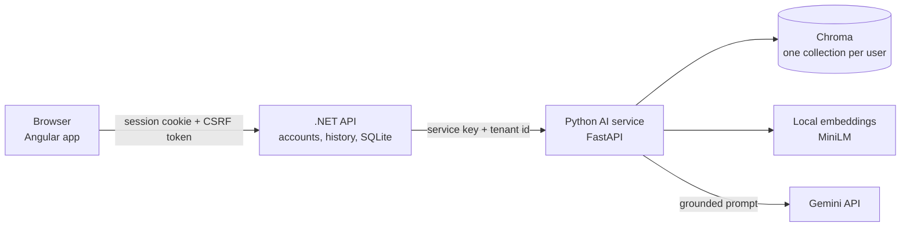

# Notebook Assistant

Upload Markdown documents and ask questions about them. Every answer comes with the passages it is based on, and when the documents do not contain the
answer the assistant says so instead of guessing. Each person's documents are kept strictly apart from everyone else's.

A portfolio project: an Angular app and an ASP.NET Core API in front of a Python retrieval service, designed to run on free tiers and a laptop (8 GB RAM).

| | |
|---|---|
|  |  |
| An answer, with the passages it cites. Real model output. | Documents are stored here and indexed for search. |

<details>
<summary>More screenshots: a clarifying question, dark mode, phone width, sign-in</summary>

| | | |
|---|---|---|
|  |  |  |



</details>

The screenshots are generated by `npm run screenshots` in [e2e](e2e/README.md), against the real stack and the real model.

## What it does

- **Grounded answers with checked citations.** The model is given numbered passages and must cite them; the code verifies that every citation names a passage it was actually
  given. An answer that cites nothing valid is shown as "no supported answer", with none of its text.
- **It abstains.** If the documents do not contain the answer, you are told so. This is measured against near-miss questions that sound answerable but are not.
- **Standard and agent modes.** The agent can ask a clarifying question when a question is too vague to search, or summarize a whole document. Your reply to a clarifying
  question is sent together with the original question, which found the right passage in 26 of 30 test cases against 21 of 30 for the reply alone.
- **Accounts and isolation.** Sign-in with email and password, an HttpOnly cookie session, CSRF protection, lock-out, rate limits. Every row is owned by a user and every query is
  filtered to the signed-in user, and in the AI service each user has a collection and keyword index of their own.
- **Honest failure.** A rate-limited model, a stopped request and a session that ended elsewhere each have a defined behaviour that the end-to-end tests exercise.

## How it fits together



- The **browser** only ever talks to the .NET API (in development the Angular dev server proxies `/api`, so there is one origin and no CORS to configure).
- The **.NET API** owns accounts, document text and chat history in SQLite. The database is the source of truth; the AI service's index is derived from it and can be rebuilt
  (`POST /api/documents/sync`).
- The **AI service** chunks, embeds, retrieves (dense + BM25, fused) and generates. It trusts only callers holding the shared service key, and takes the user from the API.
- The Angular client's types are **generated from the API's OpenAPI document**, which is committed and checked by a test, so the two cannot silently drift.

The design decisions, the evidence behind each, and what that evidence does *not* show are in [docs/architecture.md](docs/architecture.md).

## Run it

You need Python 3.12, the .NET 10 SDK and Node 22. Commands are for Windows PowerShell; elsewhere, swap `.venv\Scripts\` for `.venv/bin/`.

**1. Once: the Python environment.** The first run also downloads the embedding model (about 90 MB, from Hugging Face).

```bash
cd ai-service
python -m venv .venv
.venv\Scripts\pip install -r requirements.txt
```

**2. Once: the secrets.** The AI service and the API share a service key and both refuse to start without it. This script makes one, puts it in `ai-service/.env` and gives
the API the same one through `dotnet user-secrets`, without printing it. Safe to run again.

```bash
scripts\setup.ps1
```

Then add your free [Gemini API key](https://aistudio.google.com/apikey) as `GEMINI_API_KEY` in `ai-service/.env` (uploading documents works without it; questions need it).

**3. Three terminals.**

```bash
cd ai-service && .venv\Scripts\python -m uvicorn app.api:app_from_env --factory --port 8000
cd api && dotnet run --project src/NotebookApi --urls http://127.0.0.1:5247
cd web && npm install && npm start
```

Open http://localhost:4200, create an account, upload a Markdown file, and ask about it. Registration can be restricted to people with a code:
`dotnet user-secrets set "Auth:InviteCode" "<a code>" --project api/src/NotebookApi`.

## Tests

| Layer | Command | Tests | What it covers |
|---|---|---|---|
| AI service | `cd ai-service && .venv\Scripts\python -m pytest` | 125 | chunking, hybrid retrieval, grounded generation, the agent graph, the HTTP layer, tenant isolation, the service key |
| API | `cd api && dotnet test` | 158 | contract and error mapping, persistence, accounts, cookies, CSRF, lock-out, rate limits, a walk over every route anonymously, two-user isolation |
| Web | `cd web && npm test` | 266 | stores, pages, guards, interceptors, the browser-side limits (checked against the API's contract) |
| End to end | `cd e2e && npm install && npm test` | 28 | the real stack in a real browser, two users side by side, failure and retry, and an accessibility scan of every screen in light, dark and phone width |

The end-to-end tests run on ports of their own and need no Gemini key: the language model is a deterministic stand-in and everything else is real ([e2e/README.md](e2e/README.md)).
Most of the security-relevant tests were written test-first and then checked by *breaking the code on purpose* to confirm a test fails; the evidence is recorded per step in
[docs/architecture.md](docs/architecture.md).

**Evaluations** (how good the answers are, as opposed to whether the code works) need a Gemini key unless run with `--retrieval-only`:

```bash
cd ai-service
.venv\Scripts\python -m evals.hard_eval --retrieval-only    # no key
.venv\Scripts\python -m evals.hard_eval                     # about 25-40 model calls, paced for the free tier
```

## Repository layout

```
ai-service/   FastAPI service: chunking, embeddings, Chroma, hybrid retrieval, grounded generation, LangGraph agent, evals/ and experiments/
api/          ASP.NET Core API: accounts (Identity), SQLite persistence, the AI-service client, the committed OpenAPI contract (openapi/v1.json)
web/          Angular app: sign-in, documents, chat; types generated from the API contract
e2e/          Playwright end-to-end tests and the screenshot generator
docs/         architecture.md (the decision log) and the screenshots
scripts/      setup.ps1
```

## Decisions worth reading

Each is an entry in [docs/architecture.md](docs/architecture.md) with what was chosen, why, what was measured and what the measurement does not show.

- **Structure-aware chunking** under the embedding model's token limit, and why retrieval is evaluated separately from generation.
- **Hybrid retrieval** (dense + BM25 fused by rank) and an honest comparison of reranking strategies on a small corpus.
- **The agent layer**, and the finding that it adds no accuracy on clear questions at twice the model calls, but behaves differently on vague ones.
- **Clarifying questions**: three options compared on retrieval before building one, with the caveats.
- **Persistence and consistency** between a database and a derived index that cannot share a transaction.
- **Accounts and isolation** at three layers, and the bugs the tests and a live run found along the way.

## What is not here

- **Deployment.** Nothing is ready to face the internet yet: TLS (cookies are Secure outside development), forwarded headers behind a proxy, persisted Data Protection keys, a private
  network between the API and the AI service, the service key in a secret store, and per-user quotas are all deployment work. Keep it on localhost until then.
- **No email.** So no verification, password reset or account deletion. Registering a taken email says so.
- **No streaming.** An answer appears all at once, as plain text, which on the free model tier can take 5 to 45 seconds. Stop abandons the wait but not the model call.
- **Follow-up questions are not understood from earlier turns**, except an answer to a clarifying question. A conversation is a record, not context for the model.
- **One model, small hand-written evaluation sets.** The measurements are evidence, not proof; each has its caveats written next to it.

## Background

Built while following a structured AI-engineering study plan; the learning log with the experiments behind these design choices is in the companion repository `ai-engineer-journey`.
